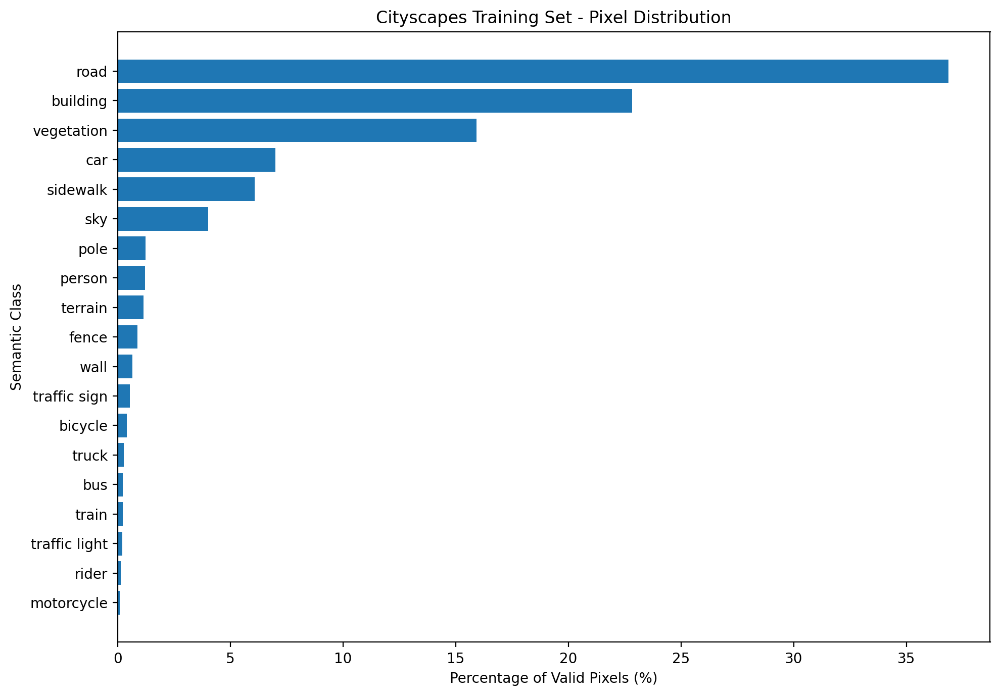
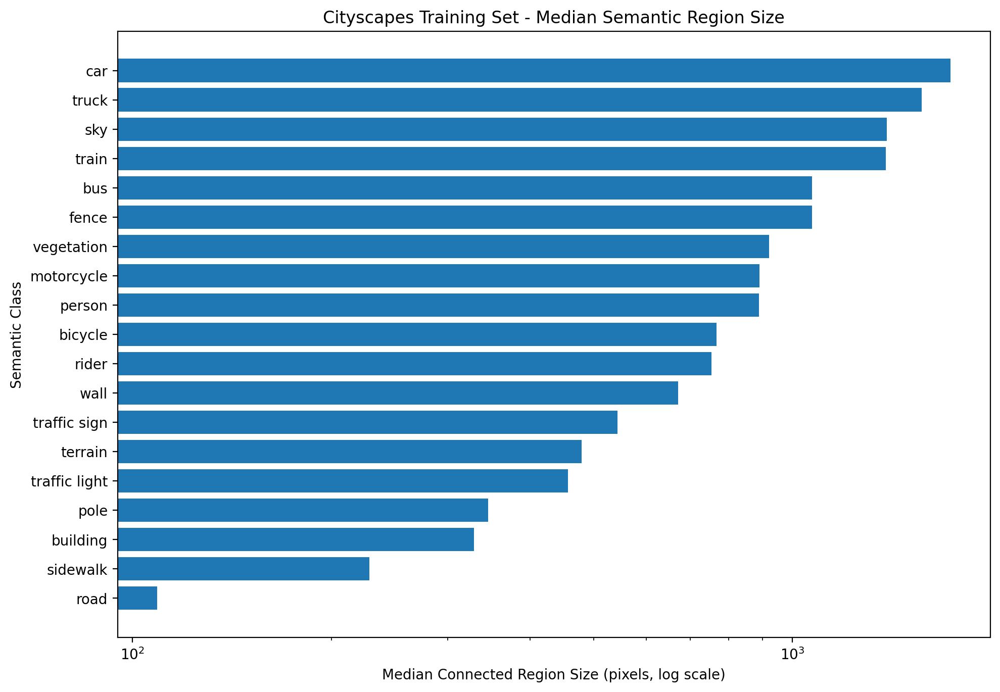
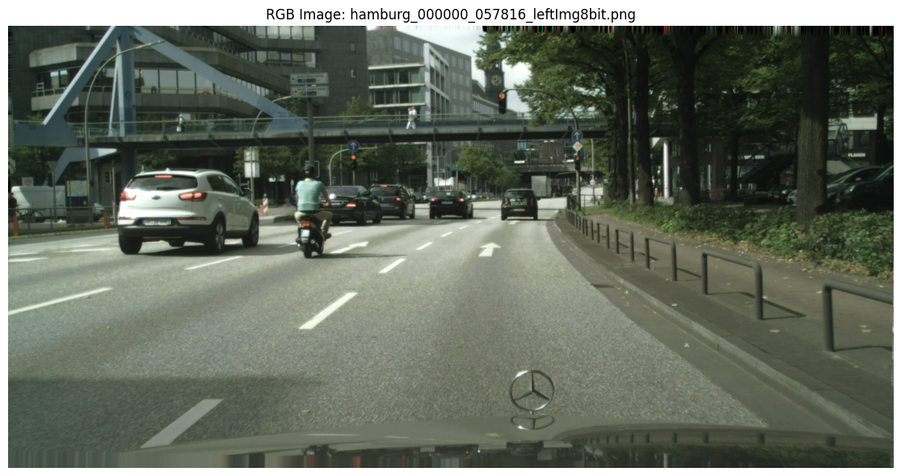
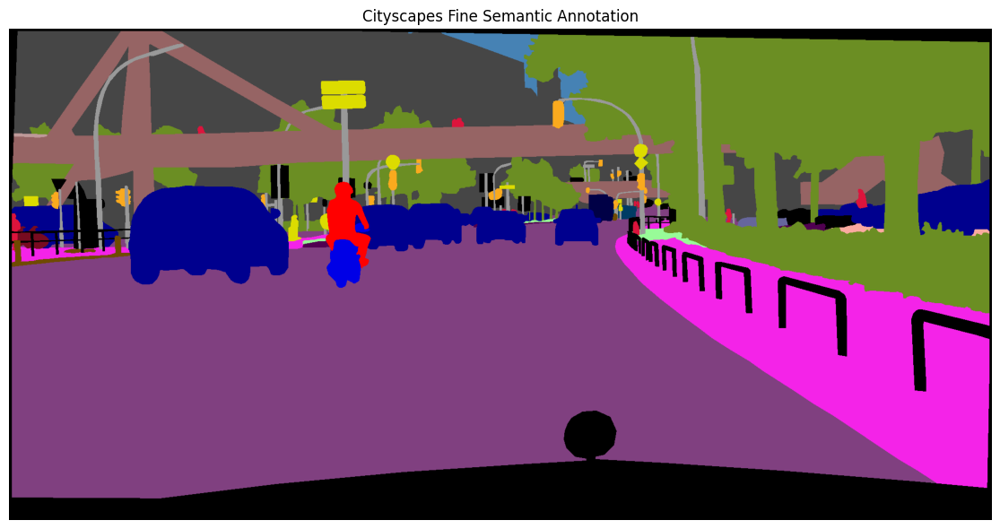
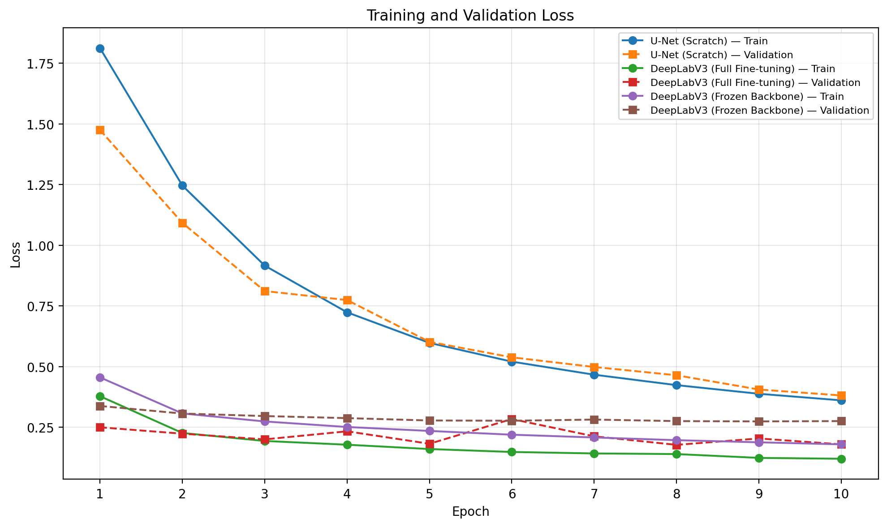
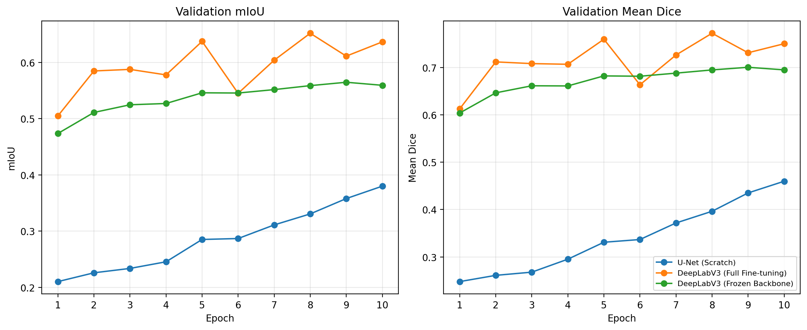
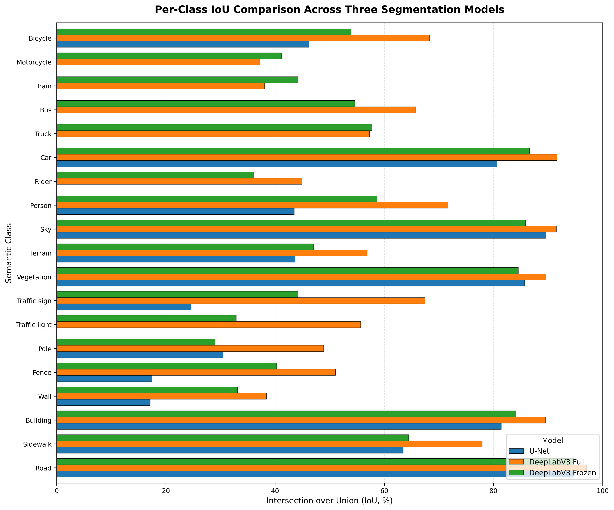
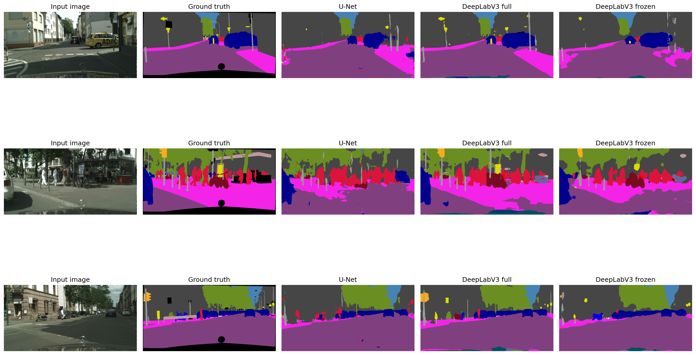

# **Deep Learning on Large-Scale Data and Specialized Tasks**

#### **Topic:** Semantic Segmentation of Urban Street Scenes using Cityscapes

**Group members:**

- Đàm Hoài An
- Nguyễn Hữu Minh Khôi
- Ngô Diễm Quyên

**Instructor:** Lê Thành Sách

---

## **1. Problem and Data**

### **Problem Statement**

This project focuses on **semantic segmentation of urban street scenes** using the Cityscapes dataset.

Given an RGB street-scene image, the model predicts a semantic class for each valid pixel. The project follows the standard Cityscapes setting with **19 evaluation classes**, including road, sidewalk, building, vegetation, person, rider, car, bus, bicycle, and other urban categories.

The main challenges include strong class imbalance, small semantic regions, scale variation, perspective, and occlusion.

---

### **Data Description and EDA**

#### **Dataset Description**

The project uses the **Cityscapes fine-annotation dataset** (`gtFine`) with RGB images from `leftImg8bit`.

| Property              | Value                                          |
| --------------------- | ---------------------------------------------- |
| Task                  | Semantic segmentation                          |
| Fine-annotated images | 5,000                                          |
| Cities                | 50                                             |
| Image resolution      | 2048 × 1024                                    |
| Evaluation classes    | 19                                             |
| Annotation            | Polygon annotations and pixel-level label maps |
| Train                 | 2,975 images                                   |
| Validation            | 500 images                                     |
| Test                  | 1,525 images                                   |

The additional coarse-annotation `train_extra` set is not used.

The official Cityscapes train/validation split is preserved without creating a custom random split. Original label IDs are mapped to training IDs **0–18**, while labels excluded from evaluation are ignored.

---

#### **Class Distribution**

Pixel statistics were computed over all **2,975 training masks**, containing:

$$
2{,}975 \times 1{,}024 \times 2{,}048
= 6{,}239{,}027{,}200
$$

pixels in total.

- **Valid semantic pixels:** 5,523,279,889 pixels (88.53%) belong to the 19 valid evaluation classes
- **Ignored pixels:** 715,747,311 (11.47%)

The class distribution among valid pixels is:

| Class         | Percentage |
| ------------- | ---------: |
| road          |    36.870% |
| building      |    22.824% |
| vegetation    |    15.929% |
| car           |     6.995% |
| sidewalk      |     6.085% |
| sky           |     4.019% |
| pole          |     1.227% |
| person        |     1.219% |
| terrain       |     1.158% |
| fence         |     0.877% |
| wall          |     0.655% |
| traffic sign  |     0.551% |
| bicycle       |     0.414% |
| truck         |     0.267% |
| bus           |     0.235% |
| train         |     0.233% |
| traffic light |     0.208% |
| rider         |     0.135% |
| motorcycle    |     0.099% |



_Figure 1. Pixel-level class distribution of the Cityscapes training set._

The dataset shows substantial **pixel-level class imbalance**. Road, building, and vegetation alone account for approximately **75.62%** of all valid pixels, while several classes contribute less than 0.3%.

This motivates the use of **mIoU, Dice, and per-class metrics** instead of relying only on overall pixel accuracy.

---

#### **Semantic Region Size**

Connected-component analysis was performed to examine the spatial sizes of semantic regions. Components are treated as **connected semantic regions**, not object instances.

A threshold of **1,024 pixels (32 × 32)** was used as an exploratory definition of a small region.

| Class         | Median Region Size | Regions < 1,024 px |
| ------------- | -----------------: | -----------------: |
| traffic light |                457 |             71.85% |
| traffic sign  |                543 |             66.50% |
| rider         |                753 |             56.77% |
| bicycle       |                767 |             56.39% |
| person        |                890 |             52.87% |
| motorcycle    |              890.5 |             52.91% |



_Figure 2. Median connected semantic-region size for each Cityscapes class._

Traffic-related and human-related classes frequently appear as small regions. Together with the pixel distribution, this indicates that Cityscapes contains both **class imbalance and strong scale variation**.

---

#### **Qualitative Inspection**

Selected RGB images and their semantic annotations were visually inspected.





_Figure 3. Example Cityscapes street scene and its fine semantic annotation._

The examples show large regions such as road, building, and vegetation together with much smaller vehicles, riders, pedestrians, poles, and traffic infrastructure. Perspective and partial occlusion further increase segmentation difficulty.

Overall, the preliminary EDA identifies four main challenges:

- strong pixel-level class imbalance;
- large variation in semantic-region size;
- small and distant foreground regions;
- perspective and occlusion in complex urban scenes.

---

## **2. Methodology and Experimental Setup**

### **Methodology**

This project evaluates two semantic segmentation architectures under three training configurations on the Cityscapes dataset:

- **U-Net (trained from scratch):** A baseline encoder–decoder architecture with skip connections.
- **DeepLabV3-ResNet50 (full fine-tuning):** DeepLabV3 initialized with an ImageNet-pretrained ResNet-50 backbone, with the backbone and segmentation head updated during training.
- **DeepLabV3-ResNet50 (frozen backbone):** The same pretrained architecture, but the ResNet-50 backbone is kept frozen while the segmentation head is trained.

All configurations predict 19 semantic classes. Cityscapes label IDs are mapped to training IDs 0–18, while labels excluded from evaluation are assigned the ignore index 255. Cross-Entropy (CE) loss is used for all three configurations.

The controlled experiment compares **full fine-tuning against a frozen backbone** while keeping the dataset split and the common training settings the same. The hypothesis is that allowing the pretrained backbone to adapt to Cityscapes will improve segmentation performance, at the cost of additional computation.

### **Experimental Setup**

The experiments use the official Cityscapes training and validation splits, containing 2,975 training images and 500 validation images, respectively.

The original images have a resolution of 2048 × 1024 pixels. For training and evaluation, images and segmentation masks are resized to 1024 × 512 pixels in width and height, respectively, corresponding to a tensor shape of 512 × 1024 in height and width. Images are normalized using ImageNet mean and standard deviation. Random horizontal flipping is applied during training.

The main training configuration is summarized below:

| Setting | U-Net | DeepLabV3 Full | DeepLabV3 Frozen |
|---|---:|---:|---:|
| Training set | 2,975 | 2,975 | 2,975 |
| Validation set | 500 | 500 | 500 |
| Input resolution (H × W) | 512 × 1024 | 512 × 1024 | 512 × 1024 |
| Number of classes | 19 | 19 | 19 |
| Loss function | Cross-Entropy | Cross-Entropy | Cross-Entropy |
| Ignore index | 255 | 255 | 255 |
| Optimizer | AdamW | AdamW | AdamW |
| Learning rate | 0.0001 | 0.0001 | 0.0001 |
| Weight decay | 0.0001 | 0.0001 | 0.0001 |
| Batch size | 12 | 2 | 2 |
| Training duration | 10 epochs | 10 epochs | 10 epochs |
| Backbone | None (trained from scratch) | ResNet-50 | ResNet-50 (frozen) |

U-Net uses 32 base channels. Both DeepLabV3 configurations use an ImageNet-pretrained ResNet-50 backbone. The full fine-tuning configuration updates the backbone parameters, whereas the frozen configuration keeps the backbone parameters fixed during training.

All experiments use random seed 43. The best checkpoint for each configuration is selected based on validation mIoU.

Model performance is evaluated using mean Intersection over Union (mIoU), mean Dice score, and validation loss. Per-class IoU is also calculated to examine differences in segmentation performance across semantic categories.

### **Compute Environment**

All experiments were conducted using Kaggle Notebooks with the following environment:

| Component | Specification |
|---|---|
| GPU | NVIDIA Tesla T4 |
| GPU memory | 14.56 GB |
| CPU | x86_64, 4 logical CPUs |
| System RAM | 31.35 GB |
| Python | 3.13.15 |
| PyTorch | 2.11.0+cu128 |
| Torchvision | 0.26.0+cu128 |
| CUDA | 12.8 |

The same random seed (43), optimizer, learning rate, weight decay, loss function, and input resolution were used across the three configurations. Batch size differs between U-Net and DeepLabV3 due to their different memory requirements.

### **Training Time**

The total training time was calculated by summing the recorded epoch durations over the ten training epochs.

| Model | Total Training Time | Average per Epoch |
|---|---:|---:|
| U-Net | 81.81 min | 8.18 min |
| DeepLabV3 Full | 96.28 min | 9.63 min |
| DeepLabV3 Frozen | 47.88 min | 4.79 min |

Freezing the ResNet-50 backbone reduced the recorded training time by approximately 50.2% compared with full fine-tuning. These measurements reflect the current Kaggle environment and implementation.

#### **Controlled Experiment**

The controlled experiment investigates whether fine-tuning the pretrained ResNet-50 backbone improves semantic segmentation performance compared with keeping the backbone frozen.

| Component | Description |
|---|---|
| Hypothesis | Full fine-tuning will improve validation mIoU and mean Dice by adapting pretrained features to Cityscapes. |
| Changed factor | ResNet-50 backbone: trainable (full fine-tuning) versus frozen. |
| Fixed factors | For the two DeepLabV3 configurations: Cityscapes train/validation split, input resolution, number of epochs, batch size, optimizer, learning rate, loss function, and evaluation metrics. |
| Metrics | Validation mIoU, mean Dice, validation loss, and training time. |
| Decision criterion | Compare the best validation mIoU and mean Dice, together with the additional training cost. |

The experiment is designed to examine the effect of backbone fine-tuning within the same DeepLabV3 architecture. The U-Net configuration serves as a separate baseline and is not part of this controlled comparison.

---

## **3. Results and Analysis**

### **Quantitative Results**

Table 1 summarizes the best recorded validation results obtained by the three evaluated segmentation configurations. DeepLabV3 with a fully fine-tuned ResNet-50 backbone achieved the highest performance, with a validation mIoU of 65.19% and a mean Dice score of 77.25%. The frozen-backbone configuration achieved 56.47% mIoU and 70.06% mean Dice, while U-Net trained from scratch achieved 37.99% mIoU and 45.98% mean Dice according to its training history.

| Metric | U-Net (Scratch) | DeepLabV3 (Full Fine-tuning) | DeepLabV3 (Frozen Backbone) |
|---|---:|---:|---:|
| Best epoch | 10 | 8 | 9 |
| Best validation mIoU | 37.99% | 65.19% | 56.47% |
| Mean Dice at best epoch | 45.98% | 77.25% | 70.06% |
| Validation loss at best epoch | 0.3814 | 0.1779 | 0.2744 |
| Training loss at best epoch | 0.3613 | 0.1400 | 0.1884 |
| Number of parameters | 7.85 M | 39.64 M | 39.64 M |

**Table 1.** Best recorded validation performance of the evaluated segmentation configurations.

DeepLabV3 with full fine-tuning outperformed U-Net by 27.20 percentage points in mIoU and 31.27 percentage points in mean Dice, based on the recorded training-history metrics. Compared with the frozen-backbone configuration, full fine-tuning improved mIoU by 8.72 percentage points and mean Dice by 7.19 percentage points.

These results indicate that DeepLabV3-ResNet50 achieved higher validation performance than the U-Net baseline under the implemented experimental setup. The comparison between the two DeepLabV3 configurations also suggests that adapting the pretrained backbone to Cityscapes was beneficial. However, the comparison between U-Net and DeepLabV3 evaluates complete model configurations and does not isolate the effect of architecture or pretraining independently.

The best checkpoint for each model was selected according to its recorded validation mIoU. All models were trained for ten epochs.

An independent evaluation of the saved checkpoints across all 500 validation images produced an mIoU of 37.81% for U-Net, compared with 37.99% in its training history. The DeepLabV3 results remained consistent with their recorded values. The small discrepancy for U-Net has not yet been fully resolved; therefore, the training-history value is retained in Table 1, while the independently evaluated value is reported with the per-class results.


### **Inference Benchmark**

Inference performance was measured on the NVIDIA Tesla T4 GPU using batch size 1, FP32 precision, and an input resolution of 512 × 1024. The benchmark included 10 warm-up iterations followed by 30 measured iterations, with CUDA synchronization used for timing.

The input tensor was already stored on the GPU. Therefore, the measurements represent model forward-pass time only and exclude image preprocessing and CPU-to-GPU data transfer.

| Model | Parameters (M) | Mean Latency (ms) | Median Latency (ms) | P95 Latency (ms) | Throughput (FPS) | Peak GPU Memory (GB) |
|---|---:|---:|---:|---:|---:|---:|
| U-Net | 7.85 | 49.18 | 49.31 | 49.87 | 20.33 | 0.662 |
| DeepLabV3 Full | 39.64 | 208.06 | 208.51 | 210.14 | 4.81 | 0.411 |
| DeepLabV3 Frozen | 39.64 | 210.12 | 210.41 | 211.98 | 4.76 | 0.411 |

**Table 2.** Inference benchmark on the NVIDIA Tesla T4 GPU.

U-Net achieved the lowest inference latency and the highest throughput, processing approximately 4.2 times as many frames per second as the fully fine-tuned DeepLabV3 model. However, its lower inference cost was accompanied by substantially lower validation segmentation performance.

The two DeepLabV3 configurations showed nearly identical inference latency and peak GPU memory usage. This is expected because freezing the backbone changes the training behavior but does not change the model architecture used during inference.

Interestingly, U-Net used less model parameters but showed higher peak GPU memory usage in this benchmark. This indicates that parameter count alone does not determine inference memory consumption; intermediate feature maps and activation tensors also contribute to GPU memory requirements.

### **Training Curves**




**Figure 4.** Training and validation loss curves for U-Net, DeepLabV3 with full fine-tuning, and DeepLabV3 with a frozen backbone.



**Figure 5.** Validation mIoU and mean Dice scores across training epochs for the three evaluated models.

The training curves show that all three models improved during training, although their convergence behavior and final performance differed. U-Net exhibited a consistent decrease in training and validation loss, with its validation mIoU increasing progressively throughout the ten epochs. However, its performance remained substantially lower than that of the DeepLabV3 configurations.

DeepLabV3 with full fine-tuning achieved the highest validation mIoU at epoch 8. Its validation metrics fluctuated slightly across epochs, indicating that performance did not improve monotonically throughout training. The frozen-backbone configuration showed a more gradual improvement and reached its highest recorded mIoU at epoch 9.

The best validation checkpoint was therefore selected separately for each model rather than assuming that the final epoch always produced the best result.

### **Per-Class Performance and Error Analysis**

The per-class evaluation provides further insight into the segmentation performance of the three evaluated models. Table 2 presents the IoU scores for all 19 semantic classes on the Cityscapes validation set, while Figure 6 visualizes the comparison across models.

| Class | U-Net (Scratch) | DeepLabV3 (Full Fine-tuning) | DeepLabV3 (Frozen Backbone) |
|---|---:|---:|---:|
| Road | 94.69 | 97.04 | 94.75 |
| Sidewalk | 63.46 | 77.93 | 64.45 |
| Building | 81.43 | 89.51 | 84.14 |
| Wall | 17.14 | 38.40 | 33.12 |
| Fence | 17.45 | 51.03 | 40.28 |
| Pole | 30.49 | 48.87 | 29.02 |
| Traffic light | 0.00 | 55.65 | 32.89 |
| Traffic sign | 24.60 | 67.45 | 44.13 |
| Vegetation | 85.68 | 89.60 | 84.56 |
| Terrain | 43.60 | 56.88 | 47.02 |
| Sky | 89.58 | 91.52 | 85.85 |
| Person | 43.52 | 71.67 | 58.63 |
| Rider | 0.00 | 44.91 | 36.07 |
| Car | 80.61 | 91.61 | 86.60 |
| Truck | 0.00 | 57.30 | 57.68 |
| Bus | 0.00 | 65.73 | 54.57 |
| Train | 0.00 | 38.06 | 44.20 |
| Motorcycle | 0.00 | 37.19 | 41.19 |
| Bicycle | 46.16 | 68.26 | 53.89 |

**Table 3.** Per-class IoU (%) comparison among the three segmentation models on the Cityscapes validation set.



**Figure 6.** Per-class IoU comparison among U-Net, DeepLabV3 with full fine-tuning, and DeepLabV3 with a frozen backbone on the Cityscapes validation set.

The results reveal considerable variation in segmentation performance across semantic categories. DeepLabV3 with full fine-tuning achieved its highest IoU values on road (97.04%), car (91.61%), sky (91.52%), vegetation (89.60%), and building (89.51%). In contrast, motorcycle (37.19%), train (38.06%), wall (38.40%), and rider (44.91%) were among its most challenging classes.

The comparison also highlights differences between the model configurations. DeepLabV3 with full fine-tuning achieved higher IoU than the frozen-backbone configuration on 16 out of 19 classes. Both DeepLabV3 configurations obtained non-zero IoU across all classes. In contrast, U-Net achieved 0% IoU for traffic light, rider, truck, bus, train, and motorcycle, indicating substantial difficulties in segmenting these categories under the evaluated validation setup.

These findings are consistent with the exploratory data analysis, which showed that several traffic-related and human-related classes occupy relatively small proportions of the training pixels. For example, motorcycle accounted for only 0.099% of valid training pixels, while rider accounted for 0.135%. Traffic light and traffic sign also represented relatively small proportions of the training pixels and frequently appeared as small semantic regions. Such characteristics may make these classes more challenging to segment accurately.

### **Qualitative Prediction Comparison**



**Figure 7.** Qualitative comparison of the input images, ground-truth annotations, and predictions from U-Net, DeepLabV3 with full fine-tuning, and DeepLabV3 with a frozen backbone.

The qualitative comparison illustrates differences in the predicted semantic regions across the evaluated models. In the selected validation samples, U-Net produced more irregular boundaries and noisier predictions, while DeepLabV3 with full fine-tuning generated more coherent segmentation results. The frozen-backbone model also benefited from pretrained features, although its quantitative performance was lower than that of the fully fine-tuned configuration.

Small or thin structures, including poles and traffic infrastructure, as well as boundaries between adjacent semantic regions, remained challenging. These observations are consistent with the dataset characteristics identified during exploratory data analysis.

The qualitative analysis is based on three selected validation samples. It provides illustrative examples of model behavior but is not sufficient to characterize performance across the entire validation set.

### **Discussion**

The experimental results highlight the differences in segmentation performance and computational efficiency among the three evaluated configurations. DeepLabV3 with a fully fine-tuned ResNet-50 backbone achieved the highest validation performance, substantially outperforming U-Net trained from scratch. Although this comparison involves differences in both architecture and initialization, the results suggest that the DeepLabV3 configuration provides a more effective representation for the evaluated Cityscapes segmentation task. The contribution of architecture and pretraining cannot be independently determined from the current experiments.

The controlled comparison between the two DeepLabV3 configurations provides further insight into the effect of backbone fine-tuning. Full fine-tuning achieved an mIoU of 65.19% and a mean Dice score of 77.25%, compared with 56.47% and 70.06%, respectively, for the frozen-backbone configuration. This improvement suggests that adapting the pretrained ResNet-50 features to Cityscapes is beneficial for segmentation performance. The results support the hypothesis that allowing the backbone to learn task-specific representations improves performance compared with training only the segmentation head.

The per-class evaluation further demonstrates that performance varies considerably across semantic categories. DeepLabV3 with full fine-tuning achieved high IoU values for large and visually prominent classes, including road, car, sky, vegetation, and building. In contrast, motorcycle, train, wall, and rider remained among the most challenging classes. U-Net obtained zero IoU for six categories, indicating that it struggled to produce correctly overlapping predictions for these classes under the evaluated setup. These findings are consistent with the class imbalance and semantic-region size variation observed during EDA, although the individual effects of class frequency, object size, and visual complexity were not isolated.

The training-time results reveal a trade-off between segmentation performance and training efficiency. Full fine-tuning required 96.28 minutes across ten epochs, whereas freezing the ResNet-50 backbone reduced the total training time to 47.88 minutes, a reduction of approximately 50.2%. However, this lower training cost was accompanied by decreases of 8.72 percentage points in mIoU and 7.19 percentage points in mean Dice. Therefore, freezing the backbone can reduce computational requirements during training, but it may limit the model's ability to adapt its feature representations to the target dataset.

Inference benchmarking showed a different trade-off. U-Net achieved the highest throughput at 20.33 FPS, compared with 4.81 FPS for DeepLabV3 Full and 4.76 FPS for DeepLabV3 Frozen. Despite the shorter training time of the frozen-backbone configuration, its inference latency remained nearly identical to that of full fine-tuning. This is expected because freezing the backbone affects parameter updates during training but does not remove backbone computations during inference. U-Net therefore offers faster inference in the measured setting, while DeepLabV3 Full provides substantially higher segmentation accuracy.

Overall, DeepLabV3 with full fine-tuning is the strongest configuration when validation segmentation accuracy is the primary objective. The frozen-backbone configuration offers a more efficient training process with lower validation performance, whereas U-Net provides higher inference throughput at the cost of segmentation accuracy. These conclusions are limited to the selected architectures, ten-epoch training schedule, input resolution, hardware, and validation-based evaluation. Further experiments with longer training schedules, additional architectures, and different input resolutions would be needed to determine whether these trade-offs remain consistent under other settings.

### **Error Analysis**

The per-class evaluation and selected validation predictions reveal several challenging aspects of semantic segmentation:

1. **Small and infrequent classes:** Motorcycle and rider achieved relatively low IoU values in the fully fine-tuned DeepLabV3 model, at 37.19% and 44.91%, respectively. These classes account for only 0.099% and 0.135% of valid training pixels. Their limited pixel representation may make it more difficult for the models to learn discriminative features. However, the current experiments do not establish class frequency as the direct cause of their lower IoU.

2. **Thin structures and small objects:** Pole and traffic light achieved IoU values of 48.87% and 55.65%, respectively. Their relatively small spatial extent can make accurate pixel-level classification challenging. In addition, resizing the original images to 512 × 1024 may remove fine details that are important for distinguishing these structures.

3. **Imprecise segmentation boundaries:** The selected qualitative examples show irregular or less precise boundaries around some adjacent semantic regions and thin objects. Such errors can reduce IoU because even small boundary deviations may affect a considerable proportion of the pixels belonging to small regions.

4. **Occlusion and perspective:** Distant objects, partially occluded vehicles, and overlapping street-scene elements can have ambiguous visual boundaries or limited visible features. These conditions may contribute to incorrect pixel classification, although their individual effects were not separately measured.

The qualitative comparison also shows that U-Net produced noisier predictions and less coherent boundaries than the fully fine-tuned DeepLabV3 model in the three selected validation samples. These examples illustrate differences in prediction quality but cannot establish how frequently these errors occur across the entire validation set.

A more comprehensive error analysis would require systematic examination of predictions across all validation images. A confusion matrix and per-class false-positive and false-negative analysis could help identify specific class-confusion patterns and distinguish missed objects from incorrect class assignments. These analyses are beyond the scope of the current experiments.

---

## **4. Limitations and Conclusion**
### **Limitations**

This experiment has several limitations:

1. **Limited training duration:** Each model was trained for ten epochs. Longer training may produce different results and potentially improve segmentation performance.

2. **Input resolution:** Images were resized to 512 × 1024, which may remove details from small objects and thin structures, potentially affecting their segmentation accuracy.

3. **Limited model comparison:** Only U-Net and DeepLabV3-ResNet50 were evaluated, with DeepLabV3 tested under full fine-tuning and frozen-backbone configurations. Other segmentation architectures were not investigated.

4. **Limited qualitative evaluation:** The qualitative comparison uses three selected validation samples. Although these examples illustrate differences in prediction quality, a broader evaluation would be needed to characterize segmentation errors more reliably.

5. **Validation-based evaluation:** Model selection and performance evaluation were based on the Cityscapes validation set. The reported results therefore do not establish how well the models generalize to unseen test data.

6. **Limited experimental controls:** The comparison does not independently isolate the effects of architecture, ImageNet pretraining, and backbone fine-tuning. Additional controlled experiments would be required to investigate the individual contributions of these factors.

7. **No official test evaluation:** The official Cityscapes test annotations are not publicly available for ordinary local evaluation. Therefore, all reported segmentation metrics are based on the validation set.

8. **Re-evaluation discrepancy:** The U-Net checkpoint achieved 37.99% mIoU in the recorded training history, while a separate evaluation using the saved checkpoint produced 37.81%. Although the difference is small, this discrepancy should be considered when interpreting and reproducing the results.

### **Conclusion**

This project implemented and evaluated semantic segmentation models on the Cityscapes dataset using its standard 19-class evaluation setting. Three configurations were examined: U-Net trained from scratch, DeepLabV3-ResNet50 with full fine-tuning, and DeepLabV3-ResNet50 with a frozen backbone.

Among the evaluated configurations, DeepLabV3 with full fine-tuning achieved the best validation performance, obtaining an mIoU of 65.19% and a mean Dice score of 77.25%. The frozen-backbone configuration achieved 56.47% mIoU, while U-Net achieved 37.99% according to its recorded training history. These results indicate that DeepLabV3-ResNet50 performed better than the U-Net baseline under the implemented experimental setup. The comparison between the two DeepLabV3 configurations also suggests that fine-tuning the pretrained backbone improved segmentation performance.

The per-class evaluation revealed substantial differences across semantic categories. DeepLabV3 with full fine-tuning performed particularly well on road, car, sky, vegetation, and building, while motorcycle, train, wall, and rider remained more challenging. The qualitative examples also illustrated differences in prediction coherence and boundary quality among the evaluated models.

The computational measurements further revealed a trade-off between segmentation accuracy and efficiency. U-Net achieved the highest inference throughput at 20.33 FPS, while DeepLabV3 with full fine-tuning achieved 4.81 FPS and provided the best segmentation accuracy. Freezing the backbone reduced the recorded training time by approximately 50.2% compared with full fine-tuning, but did not provide a meaningful improvement in inference speed.

Overall, DeepLabV3 with full fine-tuning provided the best balance when segmentation accuracy was the primary objective, whereas U-Net offered faster inference and the frozen-backbone configuration reduced training cost. These findings are limited to the selected architectures, training duration, input resolution, hardware, and validation-based evaluation. Future work could investigate additional segmentation architectures, longer training schedules, higher input resolutions, and more comprehensive error analysis.

---

## **5. Project Links**

- **Source code and experiment artifacts:** [GitHub repository – Assignment2](https://github.com/Sunnyngooo/CO3133_Group05_Assignment/tree/main/assignment2)
- **Report:** [Report](https://drive.google.com/file/d/1MX_NZdktRhL2LnM11AKRDV6P3VkRM5aS/view?usp=sharing)
- **Presentation slides:** [Presentation Slides](https://canva.link/gtw7zeadkn7f3bm)
- **YouTube presentation video:** [YouTube presentation](https://youtu.be/udnYHyNk3KA)

The GitHub repository contains the source code, training logs, and configuration files required to inspect the reported experiments. These files are available in the `main` branch.

Due to the large file sizes, the trained model checkpoints are not stored directly in the GitHub repository. Instead, the checkpoint files are provided as ZIP archives in a separate Kaggle Dataset, accessible through the link above. This separation allows the source code and experiment records to remain accessible through GitHub while providing a separate location for downloading the trained model weights.

### Checkpoint and Reproduction Instructions

The reported results correspond to the following selected checkpoints and experiment records:

| Result | Configuration | Checkpoint archive | Experiment/log path |
|---|---|---|---|
| U-Net: 37.99% mIoU | U-Net trained from scratch | U-Net checkpoint ZIP (Kaggle Dataset) | `assignment2/unet-backup/outputs/assignment2/unet_history.csv` |
| DeepLabV3 Full: 65.19% mIoU | DeepLabV3-ResNet50, full fine-tuning | DeepLabV3 Full checkpoint ZIP (Kaggle Dataset) | `assignment2/deeplab-backup/runs/deeplabv3/full_run/outputs/deeplabv3_history.csv` |
| DeepLabV3 Frozen: 56.47% mIoU | DeepLabV3-ResNet50, frozen backbone | DeepLabV3 Frozen checkpoint ZIP (Kaggle Dataset) | `assignment2/frozen-backup/outputs/deeplabv3_history.csv` |

The corresponding training configuration files are provided in the GitHub repository:

- **U-Net:** `assignment2/unet-backup/outputs/assignment2/run_config.yaml`
- **DeepLabV3 Full:** `assignment2/deeplab-backup/runs/deeplabv3/full_run/outputs/run_config.yaml`
- **DeepLabV3 Frozen:** `assignment2/frozen-backup/outputs/run_config.yaml`

All paths above are relative to the root directory of the cloned repository, except for the checkpoint archives, which are hosted separately on Kaggle.

### Reproduction Procedure

To reproduce or inspect the experiments, follow these steps:


1. Clone the repository:

   ```bash
   git clone -b A2-training https://github.com/sunnyngooo/CO3133_Group05_Assignment.git
   cd CO3133_Group05_Assignment
   ```

2. Install the dependencies specified in the repository's environment documentation. Download the Cityscapes dataset separately and organize it according to the directory structure expected by the project.

3. Download the required checkpoint ZIP archives from the Kaggle Dataset and extract them to access the trained model weights. The training logs and configuration files can be inspected directly from the GitHub repository.

4. Select the YAML configuration corresponding to the model to be reproduced. The recorded experiments used random seed 43, the AdamW optimizer with a learning rate of 1e-4 and weight decay of 1e-4, Cross-Entropy loss, and 10 recorded training epochs. The U-Net configuration used a batch size of 12, while both DeepLabV3 configurations used a batch size of 2.

5. Run the corresponding training procedure documented in the repository. Alternatively, use the downloaded checkpoints to evaluate the trained models without repeating the training process.

6. Evaluate the selected checkpoint on the official Cityscapes validation split using the project's evaluation implementation. For a consistent comparison, maintain the same dataset split, input resolution (512 × 1024), preprocessing pipeline, evaluation protocol, and model-selection criterion. The reported checkpoints were selected based on the highest validation mIoU.

7. For reproducibility, record the repository commit hash, configuration file, checkpoint archive, and evaluation results associated with each experiment.

**Reproduction Note:** The GitHub repository and Kaggle Dataset serve complementary purposes. GitHub provides the source code, training histories, and configuration files, while Kaggle hosts the trained model checkpoints because of their large file sizes. Reproducing the experiments requires the Cityscapes dataset and the appropriate software environment. The provided checkpoints and experiment records allow users to inspect and evaluate the reported models without having to retrain them.

---

## **6. AI Usage Disclosure**
The following section documents the AI assistance used during the development and documentation of Assignment 2. AI-generated suggestions were reviewed, edited, and verified by the responsible group member. Experimental results were obtained from the actual implementation and evaluation process rather than generated by AI.

### 6.1 AI Tool Disclosure

**Tool:** ChatGPT (GPT-6)

**Used by:** Đàm Hoài An

**Time / Development stage:** During implementation, experimentation, result analysis, and report preparation (2026).

**Task:** Concept explanation, Python/PyTorch and Kaggle troubleshooting, interpretation of training metrics and evaluation results, and technical writing review.

**Prompt summary:** Asked for explanations of semantic segmentation concepts, assistance with debugging training and evaluation code, interpretation of model performance, and feedback on research-style English writing.

**AI contribution:** Provided conceptual explanations, debugging suggestions, analysis guidance, and draft wording. The student reviewed, modified, and integrated relevant suggestions. AI-generated outputs were not treated as experimental evidence.

**Student verification:** Cross-checked technical suggestions and reported information against the project source code, YAML configurations, training history CSV files, saved checkpoints, validation evaluation outputs, and inference benchmark results.

**Affected files/sections:** `docs/assignment2.md`, including methodology, experimental results, per-class performance, discussion, error analysis, limitations, conclusion, and project documentation.

**Sources used for verification:** Project source code, experiment configurations, training logs, checkpoint files, validation evaluation outputs, and inference benchmark results.

**Responsible member:** Đàm Hoài An

### 6.2 AI Usage Responsibility

The group remains responsible for the final implementation, experimental methodology, reported results, analysis, and submitted content. No AI-generated result was accepted as experimental evidence without verification against the project's code, logs, dataset, or relevant technical documentation.

---

## **References**

[1] M. Cordts et al., “The Cityscapes Dataset for Semantic Urban Scene Understanding,” _CVPR_, 2016.

[2] O. Ronneberger, P. Fischer, and T. Brox, “U-Net: Convolutional Networks for Biomedical Image Segmentation,” _MICCAI_, 2015.

[3] L.-C. Chen, G. Papandreou, F. Schroff, and H. Adam, “Rethinking Atrous Convolution for Semantic Image Segmentation,” arXiv:1706.05587, 2017.

[4] Cityscapes Dataset: https://www.cityscapes-dataset.com/

[5] Cityscapes Scripts and Label Definitions: https://github.com/mcordts/cityscapesScripts
