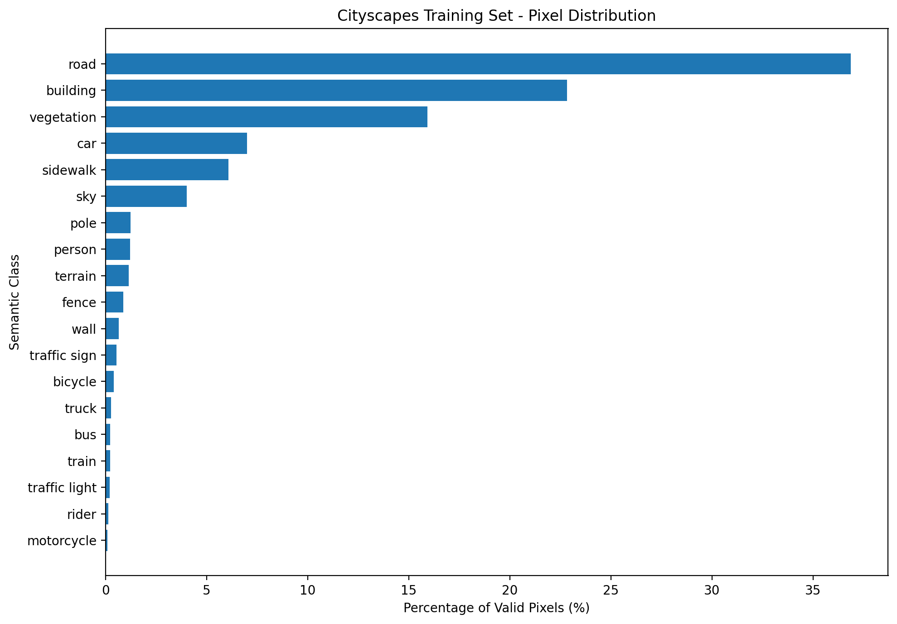
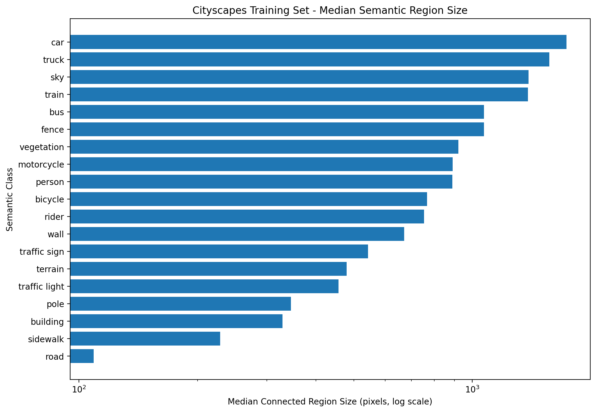
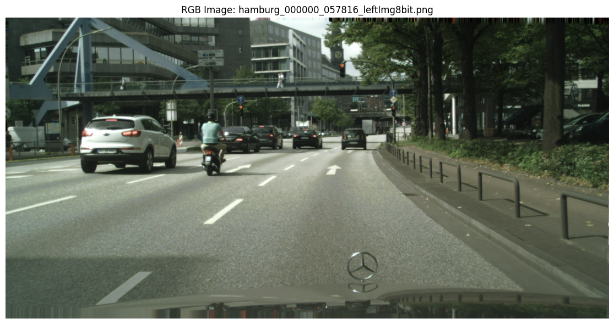
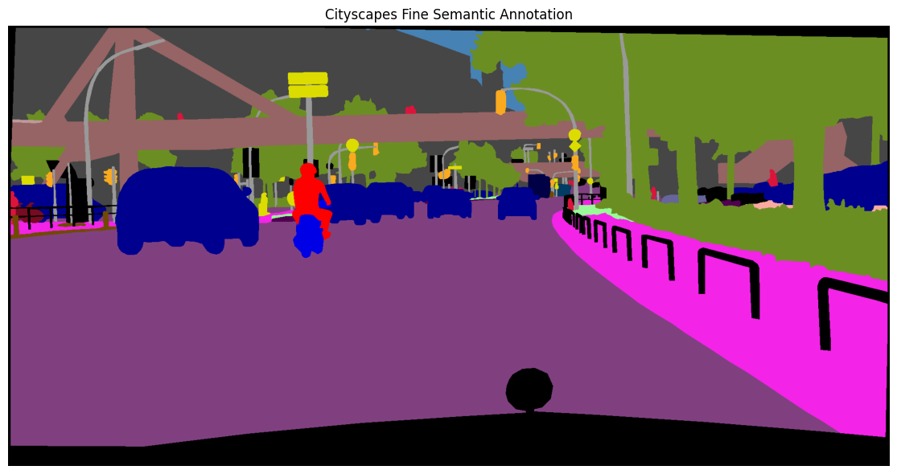
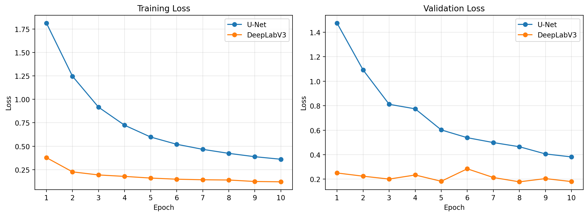
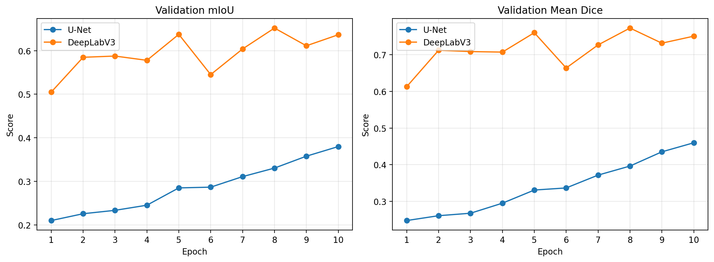
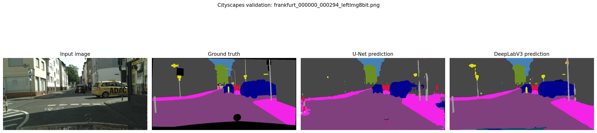

# **Deep Learning on Large-Scale Data and Specialized Tasks**

#### **Topic:** Semantic Segmentation of Urban Street Scenes using Cityscapes

**Group members:**

- Đàm Hoài An
- Nguyễn Hữu Minh Khôi
- Ngô Diễm Quyên

**Instructor:** Lê Thành Sách

---

## **1. Problem and Data**

### **Problem Statement**

This project focuses on **semantic segmentation of urban street scenes** using the Cityscapes dataset.

Given an RGB street-scene image, the model predicts a semantic class for each valid pixel. The project follows the standard Cityscapes setting with **19 evaluation classes**, including road, sidewalk, building, vegetation, person, rider, car, bus, bicycle, and other urban categories.

The main challenges include strong class imbalance, small semantic regions, scale variation, perspective, and occlusion.

---

### **Data Description and EDA**

#### **Dataset Description**

The project uses the **Cityscapes fine-annotation dataset** (`gtFine`) with RGB images from `leftImg8bit`.

| Property | Value |
|---|---|
| Task | Semantic segmentation |
| Fine-annotated images | 5,000 |
| Cities | 50 |
| Image resolution | 2048 × 1024 |
| Evaluation classes | 19 |
| Annotation | Polygon annotations and pixel-level label maps |
| Train | 2,975 images |
| Validation | 500 images |
| Test | 1,525 images |

The additional coarse-annotation `train_extra` set is not used.

The official Cityscapes train/validation split is preserved without creating a custom random split. Original label IDs are mapped to training IDs **0–18**, while labels excluded from evaluation are ignored.

---

#### **Class Distribution**

Pixel statistics were computed over all **2,975 training masks**, containing:

$$
2{,}975 \times 1{,}024 \times 2{,}048
= 6{,}239{,}027{,}200
$$

pixels in total.

- **Valid semantic pixels:** 88.53%
- **Ignored pixels:** 11.47%

The class distribution among valid pixels is:

| Class | Percentage |
|---|---:|
| road | 36.870% |
| building | 22.824% |
| vegetation | 15.929% |
| car | 6.995% |
| sidewalk | 6.085% |
| sky | 4.019% |
| pole | 1.227% |
| person | 1.219% |
| terrain | 1.158% |
| fence | 0.877% |
| wall | 0.655% |
| traffic sign | 0.551% |
| bicycle | 0.414% |
| truck | 0.267% |
| bus | 0.235% |
| train | 0.233% |
| traffic light | 0.208% |
| rider | 0.135% |
| motorcycle | 0.099% |

*Figure 1. Pixel-level class distribution of the Cityscapes training set.*

The dataset shows substantial **pixel-level class imbalance**. Road, building, and vegetation alone account for approximately **75.62%** of all valid pixels, while several classes contribute less than 0.3%.

This motivates the use of **mIoU, Dice, and per-class metrics** instead of relying only on overall pixel accuracy.

---

#### **Semantic Region Size**

Connected-component analysis was performed to examine the spatial sizes of semantic regions. Components are treated as **connected semantic regions**, not object instances.

A threshold of **1,024 pixels (32 × 32)** was used as an exploratory definition of a small region.

| Class | Median Region Size | Regions < 1,024 px |
|---|---:|---:|
| traffic light | 457 | 71.85% |
| traffic sign | 543 | 66.50% |
| rider | 753 | 56.77% |
| bicycle | 767 | 56.39% |
| person | 890 | 52.87% |
| motorcycle | 890.5 | 52.91% |

*Figure 2. Median connected semantic-region size for each Cityscapes class.*

Traffic-related and human-related classes frequently appear as small regions. Together with the pixel distribution, this indicates that Cityscapes contains both **class imbalance and strong scale variation**.

---

#### **Qualitative Inspection**

Selected RGB images and their semantic annotations were visually inspected.

*Figure 3. Example Cityscapes street scene and its fine semantic annotation.*

The examples show large regions such as road, building, and vegetation together with much smaller vehicles, riders, pedestrians, poles, and traffic infrastructure. Perspective and partial occlusion further increase segmentation difficulty.

Overall, the preliminary EDA identifies four main challenges:

- strong pixel-level class imbalance;
- large variation in semantic-region size;
- small and distant foreground regions;
- perspective and occlusion in complex urban scenes.

---
## **2. Methodology and Experimental Setup**

### **Methodology**

This project evaluates two semantic segmentation architectures on the Cityscapes dataset: U-Net and DeepLabV3 with a ResNet-50 backbone.

- **U-Net:** Used as a baseline encoder–decoder architecture with skip connections.
- **DeepLabV3-ResNet50:** Used as a stronger segmentation model with an ImageNet-pretrained ResNet-50 backbone.

Both models predict 19 semantic classes. Cityscapes label IDs are mapped to training IDs from 0 to 18, while labels excluded from evaluation are assigned the ignore index 255.

Both models are trained using Cross-Entropy (CE) loss. The current experiment focuses on comparing architectures under the implemented training setup. Although comparing CE with CE combined with Dice loss was part of the initial plan, this loss-function ablation has not been conducted and is left for future work.

### **Experimental Setup**

The experiments use the official Cityscapes training and validation splits, containing 2,975 training images and 500 validation images, respectively.

The original images have a resolution of 2048 × 1024 pixels. For training, images and segmentation masks are resized to 1024 × 512 pixels in width and height, respectively, corresponding to a tensor shape of 512 × 1024 in height and width. Images are normalized using ImageNet mean and standard deviation. Random horizontal flipping is applied during training.

The main training configuration is summarized below:

| Setting | Value |
|---|---|
| Training set | 2,975 images |
| Validation set | 500 images |
| Input resolution (H × W) | 512 × 1024 |
| Number of classes | 19 |
| Loss function | Cross-Entropy |
| Ignore index | 255 |
| Optimizer | AdamW |
| Learning rate | 0.0001 |
| Weight decay | 0.0001 |
| Batch size | 2 |
| Training duration | 10 epochs per model |
| U-Net base channels | 32 |
| DeepLabV3 backbone | ResNet-50, ImageNet-pretrained |

Model performance is evaluated using mean Intersection over Union (mIoU), mean Dice score, and validation loss. The best recorded validation checkpoint is used when reporting each model's best result.

---

## **3. Results and Analysis**

### **Quantitative Results**

The following table summarizes the best validation results recorded during training.

| Metric | U-Net | DeepLabV3-ResNet50 |
|---|---:|---:|
| Best epoch | 10 | 8 |
| Best validation mIoU | 37.99% | 65.19% |
| Mean Dice at best epoch | 45.98% | 77.25% |
| Validation loss at best epoch | 0.3814 | 0.1779 |
| Training loss at best epoch | 0.3613 | 0.1400 |

DeepLabV3-ResNet50 achieved a validation mIoU of 65.19%, compared with 37.99% for U-Net. This represents an improvement of 27.20 percentage points. Its mean Dice score was also higher by 31.27 percentage points.

These results indicate that DeepLabV3-ResNet50 performed better than the U-Net baseline under the implemented experimental setup. However, the comparison evaluates the complete model configurations, including the pretrained backbone, rather than isolating the effect of architecture alone.

### **Training Curves**

*Figure 4. Training and validation loss curves for U-Net and DeepLabV3-ResNet50.*

*Figure 5. Validation mIoU and mean Dice score across training epochs.*

The training curves show that U-Net's validation mIoU improved progressively during the ten epochs, reaching its highest recorded value at epoch 10. DeepLabV3-ResNet50 reached its best recorded validation mIoU at epoch 8. Its validation metrics fluctuated across epochs, indicating that performance did not improve monotonically throughout training.

The best validation checkpoint was therefore selected separately for each model rather than assuming that the final epoch always produced the best result.

### **Qualitative Prediction Comparison**

*Figure 6. Input image, ground-truth annotation, U-Net prediction, and DeepLabV3-ResNet50 prediction for one validation image.*

The qualitative comparison provides an example of how the two models predict semantic classes in a street scene. The predictions can be compared with the ground-truth mask to inspect differences in segmentation boundaries and object regions.

This figure represents one validation example only. It is useful for illustrating model behavior but is not sufficient to establish performance across the entire validation set.

### **Discussion**

The quantitative results favor DeepLabV3-ResNet50 over the U-Net baseline in both mIoU and mean Dice score. One possible contributing factor is the ImageNet-pretrained ResNet-50 backbone, which provides pretrained visual features. However, the current experiment does not isolate the effect of pretraining from other differences between the two model configurations.

The exploratory data analysis also revealed class imbalance: road, building, and vegetation account for approximately 75.62% of valid training pixels. Small or infrequent classes, including motorcycles, riders, and traffic lights, occupy much smaller pixel proportions. Consequently, overall metrics may not fully reflect performance on these challenging categories.

Further analysis of per-class IoU and Dice scores is needed to determine which classes contribute most to the remaining segmentation errors.

### **Error Analysis**

The dataset analysis suggests two challenges for semantic segmentation: imbalanced class frequencies and small regions belonging to less frequent classes. These factors may make some categories harder to learn and segment accurately.

However, the current report does not yet quantify the error rate for individual classes or establish which specific classes are most frequently confused by either model. A complete error analysis should examine per-class validation metrics and representative incorrect predictions before drawing more specific conclusions.

---

## **4. Limitations and Conclusion**

### **Limitations**

This experiment has several limitations:

1. **Limited training duration:** Each model was trained for ten epochs. Longer training may produce different results.
2. **Input resolution:** Images were resized to 512 × 1024, which may remove details from small objects and thin structures.
3. **Limited model comparison:** Only U-Net and DeepLabV3-ResNet50 were evaluated.
4. **No loss-function ablation:** The planned comparison between Cross-Entropy and Cross-Entropy combined with Dice loss has not been performed.
5. **Limited qualitative evaluation:** The report includes one example of predictions. A broader sample is needed to characterize errors reliably.
6. **Validation reporting:** The reported metrics are the best validation values recorded during training. A separate full-validation evaluation using the saved best checkpoints would provide a consistent basis for further analysis.
7. **Official test set:** The official Cityscapes test annotations are not publicly available for ordinary local evaluation; therefore, the reported results are based on the validation set.

### **Conclusion**

This project implemented and compared U-Net and DeepLabV3-ResNet50 for 19-class semantic segmentation on Cityscapes. Under the recorded training setup, DeepLabV3-ResNet50 achieved the higher best validation mIoU of 65.19%, compared with 37.99% for U-Net.

The results provide an initial comparison between a baseline segmentation architecture and a model with an ImageNet-pretrained backbone. Future work should include a per-class error analysis, longer training experiments, and the planned comparison between Cross-Entropy and Cross-Entropy combined with Dice loss.

---

## **5. Project Links**

- **Source code:** https://github.com/sunnyngooo/CO3133_Group05_Assignment/tree/A2-training
- **Report:** https://sunnyngooo.github.io/CO3133_Group05_Assignment/
- **Checkpoints and training logs:** Available in the project working environment; a public download link has not yet been provided.
- **Presentation slides:** Not yet available.
- **Demo video:** Not yet available.

## **6. AI Usage Disclosure**

**Tool**

---

## **References**

[1] M. Cordts et al., “The Cityscapes Dataset for Semantic Urban Scene Understanding,” *CVPR*, 2016.

[2] O. Ronneberger, P. Fischer, and T. Brox, “U-Net: Convolutional Networks for Biomedical Image Segmentation,” *MICCAI*, 2015.

[3] L.-C. Chen, G. Papandreou, F. Schroff, and H. Adam, “Rethinking Atrous Convolution for Semantic Image Segmentation,” arXiv:1706.05587, 2017.

[4] Cityscapes Dataset: https://www.cityscapes-dataset.com/

[5] Cityscapes Scripts and Label Definitions: https://github.com/mcordts/cityscapesScripts