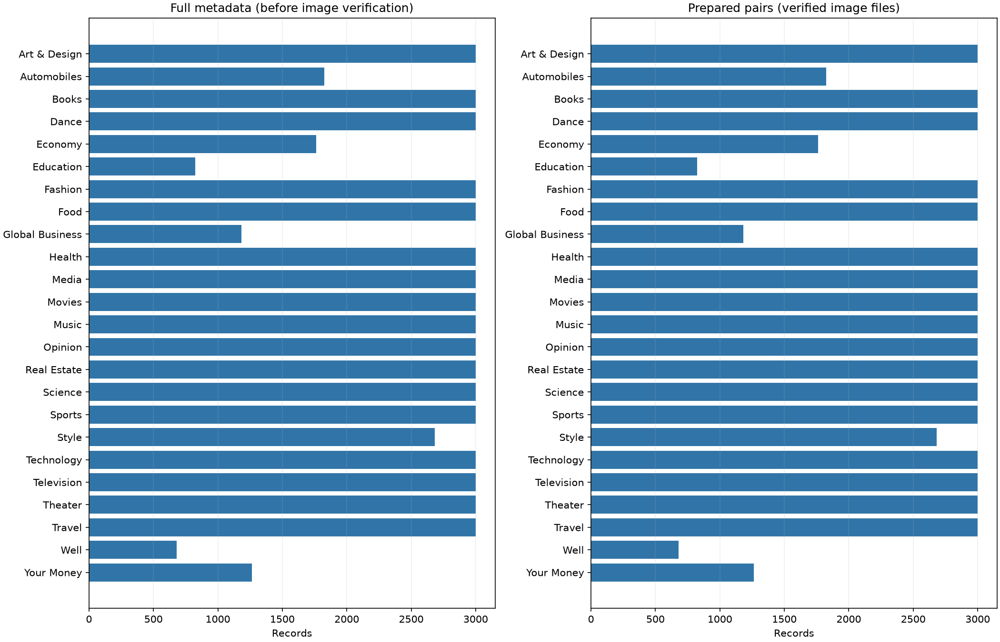
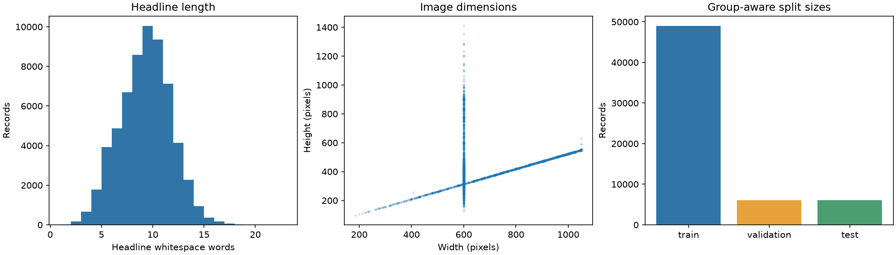

# Dataset Proposal - Assignment 3

**Title:** News Topic Classification from Images and Headlines: Feature Concatenation and Cross-Attention.

**Group:** G-05.  
**Members:** Đàm Hoài An; Nguyễn Hữu Minh Khôi; Ngô Diễm Quyên.  
**Course:** CO3133 - Deep Learning and Its Applications, Semester 261.  
**Prepared:** 14 October 2026; M1 revision: 17 November 2026.  
**Milestone:** M1 Dataset Proposal, 18 November 2026 at 23:59 GMT+7; 15% of Assignment 3.

This proposal defines the dataset, preliminary exploratory analysis, data protocol,
planned models and experimental design. M1 focuses on the dataset proposal and
preliminary EDA; model-result tables are outside this submission's scope.

## 1. Problem and objectives

Each sample is a news article with its corresponding RGB image and English
headline. The output is one of 24 N24News topic labels. The prediction unit is an
article record; the target is its `section`. Label names, article URLs and other
metadata that could reveal the target are not provided to the encoders.

Research questions:

1. Does combining images and headlines improve macro-F1 over either modality alone on the same samples?
2. Does cross-attention between headline tokens and image regions help more than concatenating pooled features?
3. When does the image supply complementary topic evidence, and when does it introduce ambiguity?

Expected challenges include short or ambiguous headlines, generic portraits,
overlapping editorial categories such as Movies/Theater/Music and Health/Well,
reused images, class imbalance and the limitations of a single news source.

## 2. Dataset source, version and usage conditions

- **Dataset:** N24News, Wang et al., LREC 2022.
- **Sources:** [Paper](https://aclanthology.org/2022.lrec-1.729.pdf) and [authors' repository](https://github.com/billywzh717/N24News).
- **Metadata revision:** `047a2bc3f4df0ea738b847a4ac3a6bd6aa2e4106`, downloaded on 14 October 2026.
- **Metadata size:** 45,402,188 bytes.
- **Metadata SHA-256:** `47145500b7161cf90914c2dfc7e4d269931e06f74958d7b89d8a6d40f82b2ede`.
- **Fields:** `section`, `headline`, `abstract`, `caption`, `image_url`, `article_url`, `image_id`. This metadata version contains neither article bodies nor predefined splits.
- **Annotations:** One editorial topic label (`section`) per article. No original bounding boxes, region-word alignments or pair-quality labels are available.
- **License:** A dataset license has not been established from the reviewed source materials. The paper's license is not treated as a dataset license; MIT or CC-BY is not assumed. Usage conditions remain an open data-provenance item.

Images are retrieved from the public asset paths referenced in the metadata,
with query-only rendering parameters removed. The original query-rendered URLs
produced NYT Published-year banners in pilot samples. A visual check of 24
original-asset images, one per class, found no such banner in those examples;
this does not establish the absence of text or banners throughout the corpus.
Original URLs and the image-source variant are retained for traceability.
These are assets retrieved at the time of this study, not a claim of pixel
identity with the authors' archived 2022 image ZIP.

## 3. Dataset scope and preliminary EDA

The full metadata audit found:

- 61,218 records across 24 classes, with 681 to 3,000 records per class.
- No missing section, headline, image URL, image ID or article URL; 303 empty captions.
- 304 repeated image URLs, accounting for 405 extra records; one repeated article URL, accounting for one extra record.
- 180 repeated headline values, accounting for 1,637 extra records. A repeated headline alone does not establish a shared event.
- Median headline length of 9 whitespace-separated words, approximately 13 at the 95th percentile and a maximum of 22. These are word counts, not tokenizer counts.

The main scope includes every technically valid pair in the 61,218-record
metadata, without a per-class cap or undersampling. Missing or corrupt pairs
would be excluded with logged reasons, rather than selected according to model
outcomes. Preparation verified all 61,218 pairs, with no exclusions, preserving
the original class imbalance. Macro-F1 is therefore the primary metric.

An initial AI-assisted visual inspection covered 120 pilot pairs, five per class:
81 had clear topic cues, 37 were weak or contextual, and two were uncertain
without further article context. All 120 IDs occur in the main selection. These
assessments are not author-provided labels, independent student annotations or
estimates of population-level pair quality. A separate review form supports
manual inspection of the full-data sample.

Full-data preparation results:

| Item | Observed value |
|---|---:|
| Valid image/headline pairs | 61,218 |
| Failed images / excluded pairs | 0 / 0 |
| Classes | 24 |
| Training pairs | 48,976 |
| Validation pairs | 6,122 |
| Test pairs | 6,120 |
| Groups | 58,727 |
| Largest group | 410 records |
| Mixed-label groups | 78 groups, 189 records |
| Strict perceptual-similarity links | 3,120 |
| Total image-file size | 6,363,053,805 bytes |

The group-aware split approximates 80/10/10 within each class without forcing
classes to have equal sizes. Disjoint sample IDs, groups, file/pixel hashes,
canonical URLs and normalized exact headlines were verified. Independent
file SHA-256, metadata, mapping and manifest checks also passed. Mixed-label
groups are retained for overlap control, not automatically treated as errors.
These are structural and file-integrity checks, not semantic verification of
all 61,218 pairs.

Evidence:

- [Metadata audit](https://github.com/Sunnyngooo/CO3133_Group05_Assignment/blob/A3/outputs/assignment3/metadata_audit.json)
- [Pilot pair review](https://github.com/Sunnyngooo/CO3133_Group05_Assignment/blob/A3/outputs/assignment3/pilot_seed44/pair_review.csv)
- [Pilot review summary](https://github.com/Sunnyngooo/CO3133_Group05_Assignment/blob/A3/outputs/assignment3/pilot_seed44/pair_review_summary.json)
- [Full-data EDA](https://github.com/Sunnyngooo/CO3133_Group05_Assignment/blob/A3/outputs/assignment3/full_seed44_original/EDA.md)
- [Full-data summary](https://github.com/Sunnyngooo/CO3133_Group05_Assignment/blob/A3/outputs/assignment3/full_seed44_original/eda_summary.json)
- [Independent preparation verification](https://github.com/Sunnyngooo/CO3133_Group05_Assignment/blob/A3/outputs/assignment3/full_seed44_original/preparation_verification.json)
- [Manual pair-review form](https://github.com/Sunnyngooo/CO3133_Group05_Assignment/blob/A3/outputs/assignment3/full_seed44_original/pair_review.csv)

Main manifests and the label mapping are stored locally under
`data/assignment3/processed/full_seed44_original/`. The earlier 12,000-record
subset is a development artifact; its splits are not used for main comparisons.
The image-source variant and custom split prevent direct claims of benchmark
equivalence with the original paper's protocol.

## 4. Cleaning, pairing and leakage prevention

- Match metadata and images using `image_id`; preserve raw image files.
- Verify image decoding, minimum dimensions and file/pixel SHA-256. Log any failed images or empty headlines and the corresponding exclusions.
- Use the same complete paired samples for all models, including unimodal baselines.
- Group canonical article/image URLs across the full metadata using transitive links; add exact file and decoded-pixel duplicates.
- Group headlines after whitespace/case normalization to prevent exact-text overlap. This is a conservative memorization control, not an event annotation.
- Group near-duplicate images conservatively using dHash distance <= 1, RGB thumbnail RMSE <= 5 and aspect-ratio difference <= 0.05; exclude flat images from perceptual matching.
- Keep each group within one split, using split seed 44 and approximately 80/10/10 train/validation/test proportions while preserving class distributions.
- Verify no cross-split intersection of sample IDs, group IDs, canonical URLs, image hashes or normalized exact headlines. Save manifests and hashes.
- Report residual event-overlap risk: complete event IDs are unavailable, so eliminating broader event-level leakage is not claimed.
- Fit any learned preprocessing statistics on training data only. Use validation for tuning and checkpoint selection; reserve test evaluation until the design and protocol are fixed.

## 5. Planned methods and losses

Images use resize/crop and normalization associated with pretrained ResNet-18
weights. Headlines use the `distilbert/distilbert-base-uncased` tokenizer,
maximum length 64, padding and attention masks. Record checkpoint/tokenizer
versions and truncation statistics.

The image encoder is ImageNet-pretrained ResNet-18, retaining spatial positions
before global pooling. The text encoder is pretrained DistilBERT, retaining token
features. Both encoders remain frozen in evaluation mode and execute online for
each batch. Linear projections map both modalities to dimension 256. Trainable
components are the projections, normalization, fusion and classification head.
An optional feature cache must pass numerical verification before use; it is
not required for the main online workflow.

| Configuration | Representation / fusion | Loss |
|---|---|---|
| U1: image-only | Image projection, normalization, mean pooling, MLP | Image-output cross-entropy |
| U2: text-only | Text projection, normalization, masked mean pooling, MLP | Text-output cross-entropy |
| F1: simple fusion | Concatenate pooled image/text vectors, MLP | Fused-output cross-entropy |
| F2: improved fusion | One text-to-image cross-attention layer, residual/normalization, pooling, concatenation and MLP | Fused-output cross-entropy |

F1 and F2 use intermediate-representation fusion. F2 uses four attention heads,
with text as queries and image positions as keys/values. Padding is excluded
from text pooling. These independently pretrained encoders do not constitute a
CLIP-aligned embedding space or verified region-level grounding. Baselines are
trained independently; no auxiliary per-modality losses are included in the main
fusion objective.

The initial recipe uses AdamW, candidate learning rates `{1e-3, 3e-4}`, dropout
0.1, batch size 32, at most 20 epochs and early-stopping patience 3. Select the
checkpoint with maximum validation macro-F1, breaking ties with lower validation
loss. Keep split seed 44 fixed. Additional training seeds 45/46 are optional if
resources permit; report the actual number of runs and any budget differences.
Use matched recipes for the controlled F1/F2 comparison.

## 6. Experimental design and evaluation

| Experiment | Hypothesis / changed factor | Fixed factors | Decision criteria |
|---|---|---|---|
| E1: U1/U2/F1 | Combining modalities supplies useful complementary evidence | Samples/split, frozen encoders, preprocessing, tuning budget and checkpoint rule | Macro-F1 difference from the stronger unimodal baseline, accuracy, per-class results and cost |
| E2: F1/F2 | Token-region interaction helps more than pooled concatenation | Frozen online encoders, preprocessing/tokenizer, projection dimensions, compatible pooling/head, split and training budget | Macro-F1 differences, variation across runs where available, latency and parameter count; report decreases as well |
| E3: remove-attention | Isolate the contribution of cross-attention | Projection, normalization, pooling, classifier and training recipe | Compare F2 against a fresh no-attention model using the same metrics and report parameter differences |

F1 may serve as the remove-attention control if its architecture matches that
variant exactly and it is trained from scratch under the same recipe. A
warm-start run with reset random/shuffle state is not an equivalent controlled
training history.

Planned outputs include accuracy, macro-F1, per-class F1, confusion matrices,
loss/metric curves, qualitative examples, support/conflict cases, error analysis,
ablation, limitations and compute costs. Better multimodal scores are not
assumed. Attention maps are illustrations, not substitutes for grounding labels.
Correctness groups require manual review before being described as support or
conflict; they do not establish causal modality contribution by themselves.

Measure end-to-end inference cost including preprocessing, tokenization,
encoders and fusion, rather than only cached-head inference. Report hardware,
software versions, seeds, total/trainable parameters, peak VRAM, training time,
checkpoint rules, configuration/split hashes and run/commit identifiers. A
single-seed comparison does not establish statistical significance.

## 7. Compute budget and schedule

The local machine runs Windows with an RTX 4060 Laptop GPU and approximately
8 GB VRAM. Preparation uses Python 3.11 and pinned dependencies in
`requirements-data.txt`; the local model environment includes CUDA-enabled
PyTorch and Transformers.

The budget covers four model configurations and one ablation on the full fixed
manifests. At an estimated 13-15 minutes per epoch for image-based configurations
under stable local conditions, four image-based runs (U1, F1, F2 and ablation)
at 20 epochs each would require approximately 17-20 hours. Allowing for the
text-only run, setup and contingency gives a planning allowance of about
20-24 hours. These are resource estimates, not a speed guarantee or a final
benchmark. Early stopping can reduce the actual number of epochs; wall time
must not be presented as uninterrupted GPU compute.

An optional float16 spatial/token feature cache would require approximately
9.1 GB for 61,218 pairs, excluding masks and metadata. Online frozen encoders
remain the primary method; cache work does not block the model experiments.

| Milestone | Deadline, 23:59 GMT+7 | Scope |
|---|---|---|
| M1: Proposal | 18 November 2026 | Dataset, preliminary EDA and experimental design |
| M2: Draft | 25 November 2026 | Quantitative image-only, text-only and simple-fusion results |
| M3: Final | 2 December 2026 | Improved fusion, ablation, analysis and complete deliverables |

## 8. Remaining data checks

- Confirm dataset usage conditions without assuming an unverified license.
- Review the sampled image/headline pairs and record reviewer observations.
- Document the original-asset image-source variant and custom group-aware split.
- Retain the limitations concerning semantic pair quality, editorial labels and incomplete event IDs.

## 9. AI Usage Disclosure

## 10. References

1. Z. Wang, X. Shan, X. Zhang, J. Yang. N24News: A New Dataset for Multimodal News Classification. LREC 2022, pp. 6768-6775. [Paper](https://aclanthology.org/2022.lrec-1.729/).
2. [N24News authors' repository](https://github.com/billywzh717/N24News), revision stated above.
3. [Course handbook v2](https://github.com/Sunnyngooo/CO3133_Group05_Assignment/blob/A3/handbook-ene-v2.pdf), Sections 7.6, 27-31 and general project requirements.
4. Multimodal lecture, `11-mm/mm.ENE.pdf`, fusion and cross-attention; local course material, not included in the repository.
5. Practical fine-tuning lecture, `05-transformers/04-Practical-Finetuning-and-Efficiency.pdf`; local course material, not included in the repository.
6. [ResNet-18 documentation](https://docs.pytorch.org/vision/stable/models/generated/torchvision.models.resnet18.html); [DistilBERT model card](https://huggingface.co/distilbert/distilbert-base-uncased).

## EDA figures

