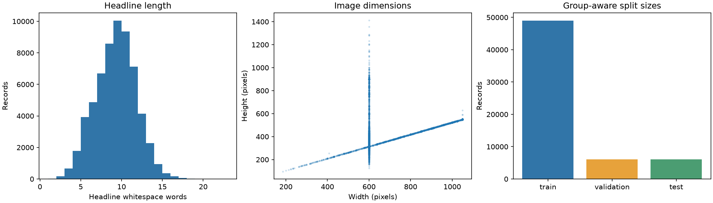

# **Multimodal Deep Learning**

#### **Topic**: Multimodal Deep Learning: Representation, Fusion, and Evaluation

**Group members:**

- Đàm Hoài An
- Nguyễn Hữu Minh Khôi
- Ngô Diễm Quyên

**Instructor:** Lê Thành Sách

## **1. Problem and data:**

**Problem statement:**

The selected task is single-label news topic classification using the image and
headline of the same article from **N24News**. The study will compare image-only,
text-only, simple feature concatenation, and cross-attention fusion models.

Dataset selection has been confirmed by the contributor. Instructor approval of
the Dataset Proposal has not yet been recorded; main experiments have not started.

**Data description and EDA**

Metadata downloaded from the authors' repository on 14 October 2026 contains
**61,218 records across 24 topics**. The schema includes `section`, `headline`,
`abstract`, `caption`, `image_url`, `article_url`, and `image_id`.

The main scope is now **all 61,218 metadata records**, with no per-class cap.
Preparation verified **61,218 complete image/headline pairs**, across all 24
classes, with **0 failed images and 0 exclusions**. The images total
**6,363,053,805 bytes**. The earlier 12,000-pair subset is retained only for
development; its splits are not used for the main experiments.
Images are retrieved from the same public asset
paths with query-only rendering parameters removed after a pilot showed
Published-year banners in metadata-rendered images. This is a documented source
variant, not a claim of pixel identity with the authors' archived ZIP.

Every image file decodes successfully. Independent actual-file SHA-256 checks
also passed for all 61,218 images, and metadata/label/path/manifest checks passed.

The full-data group-aware split is **48,976 train / 6,122 validation / 6,120 test**,
preserving class proportions near 80/10/10. Groups combine canonical article/image URL
components, exact file/pixel duplicates, strict perceptual similarities and
normalized exact headlines. The **58,727 groups** remain within a single split;
the largest group contains 410 records. There are 3,120 strict perceptual links
and 78 mixed-label groups (189 records), retained together for overlap control.
Checks confirmed disjoint sample/group IDs, image hashes, canonical URLs and
exact normalized headlines. Broader event-level overlap remains a limitation.

An AI visual review covered 120 pilot pairs (5/topic): 81 had clear topic cues,
37 were weak/contextual, and 2 were uncertain without article context. This is
not an independent human audit or a population-quality estimate; contributor
review is pending. Generic portraits and overlapping editorial topics motivate
the planned modality-comparison experiments.

Full-data preparation uses all usable pairs and retains observed class imbalance.
The main preparation run is `full_seed44_original`.
Do not mix the development manifests with this main split. The new split and
current image assets remain a custom protocol; results will not be presented as
directly comparable to the paper's original benchmark.

Human review materials for this run are local to the repository:
`outputs/assignment3/full_seed44_original/review_gallery/` and `pair_review.csv`
in its parent folder. They contain a newly sampled 120 pairs (5/topic) and are
separate from the earlier AI pilot. Instructor approval and human review remain pending.

Sources: [N24News authors' repository](https://github.com/billywzh717/N24News),
[N24News paper](https://aclanthology.org/2022.lrec-1.729.pdf).

## **2. Methodology and setup**

**Methodology**

Planned models are image-only ResNet-18, text-only DistilBERT, pooled feature
concatenation + MLP, and one-layer text-to-image cross-attention. Encoders are
initially frozen. Classification heads use cross-entropy; the primary evaluation
metric is macro-F1 with accuracy and per-class metrics. Main training has not
started pending Dataset Proposal approval.

**Experimental setup**

Preparation used Python 3.11.9 in a separate Windows environment, pinned in
`assignment3/requirements-data.txt`. The planned training hardware is an RTX
4060 Laptop GPU with about 8 GB VRAM. Split seed is 44. Model checkpoints,
training settings and compute measurements will be added after approval and
actual runs; no model scores are claimed here.

## **3. Results and Analysis**

**Results**

**Comparison and discussion**

**Error analysis**

**Limitation and conclusion:**

## **4. Links:**

**Source code:**

**Links to checkpoints:**

**Links to report/slides:**

**Links to Youtube presentation video:**

## **5. AI Usage Disclosure**

**Tool:** Codex (exact model identifier not recorded).

**Stage/purpose:** Dataset research, experimental planning, download/data-preparation
code, EDA, and AI visual review of 120 pilot image/headline pairs plus 24
original-asset images. Technical preparation and independent integrity checks
passed for all 61,218 pairs; nine automated tests passed, including full selection
and sequential/parallel grouping equivalence. No full-corpus semantic audit or
model result is claimed.

**Contributor/final verifier:** To be filled in by the group. Human review of the
new material and semantic annotations is pending. Details and representative
prompts are recorded in the repository's `AI_USAGE.md` and the
[shared disclosure](ai_usage.md).
