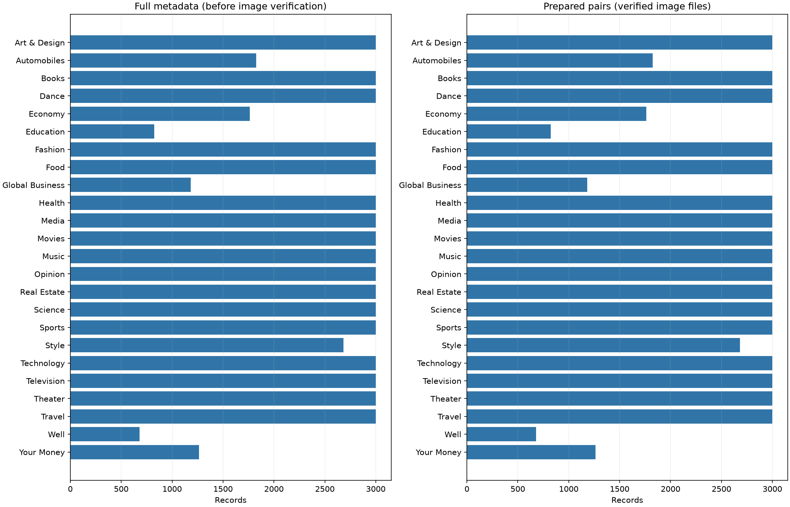
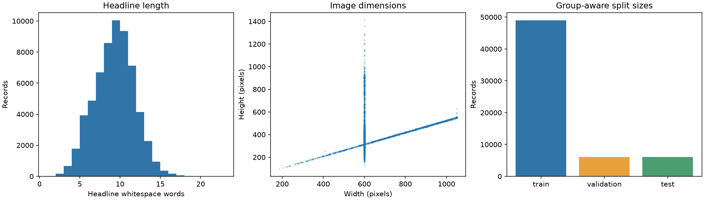

# Assignment 3 — M1 Dataset Proposal

**Course:** CO3133 — Deep Learning and Its Applications, Semester 261.  
**Group:** G-05. **Instructor:** Lê Thành Sách.  
**Members:** Đàm Hoài An; Nguyễn Hữu Minh Khôi; Ngô Diễm Quyên.

**M1 deadline:** 18 November 2026, 23:59 GMT+7. Weight: 15% of Assignment 3.

## Dataset Proposal

[Read the M1 proposal](assignment3-proposal.md)

Task: single-label classification of news topics from an article's image and
English headline. Dataset: N24News, 61,218 verified pairs across 24 classes.
Fixed group-aware split: 48,976 train / 6,122 validation / 6,120 test; seed 44.

The proposal covers dataset provenance/version and unresolved license conditions,
paired-sample validity, preliminary pair-quality review, cleaning, leakage control,
metrics, four planned configurations, ablation, compute budget and subset rules.
Technical integrity checks do not establish full semantic pair quality.

## Scope of this milestone

M1 presents the dataset proposal and preliminary EDA. Model-result tables,
completed ablation, final report, slides, video and checkpoints belong to later
milestones. No M2/M3 artifacts are included in this M1 commit proposal.

- [Proposal source in the repository](https://github.com/Sunnyngooo/CO3133_Group05_Assignment/blob/A3/assignment3/PROPOSAL.md)
- [Repository](https://github.com/Sunnyngooo/CO3133_Group05_Assignment)
- [N24News authors' repository](https://github.com/billywzh717/N24News)
- [N24News paper](https://aclanthology.org/2022.lrec-1.729/)

## AI Usage Disclosure

