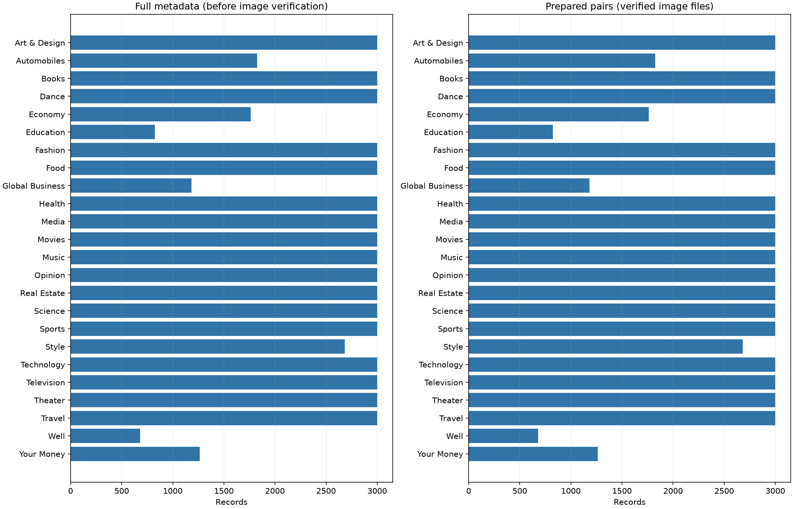

# N24News: data preparation and EDA

This report is generated from the downloaded/audited data. It contains no model results.

## Scope and provenance

- Full metadata: 61,218 records; selected records: 61,218.
- Verified, complete image/headline pairs: **61,218**, across **24 classes**.
- Image source variant: `original`; query-only rendering parameters removed from the same public asset path.
- Selection seed: 44; selected-ID SHA-256: `b59a7c547b5a620b0ffc1d5354ba8dec8afceb60f89e4941177c9e20b8634efb`.
- Download statuses: `{'cached': 25659, 'downloaded': 35559}`; valid file bytes: 6,363,053,805.
- Wall time of this downloader invocation: 1133.4 seconds. If resumed, this is not the total wall time across all invocations.
- Cleaning exclusions: `{'none': 0}`.
- All metadata records were selected without a per-class cap. Only failed images or empty headlines are excluded. Class counts retain the observed corpus imbalance; the group-aware split is custom and is not the authors' original split.

## Distribution and input sizes




Headline length is measured in whitespace words, not DistilBERT tokens. Token-length and truncation checks remain part of the post-approval encoder setup.

| Class | Prepared pairs | Train | Validation | Test |
|---|---:|---:|---:|---:|
| Art & Design | 3000 | 2400 | 300 | 300 |
| Automobiles | 1825 | 1460 | 183 | 182 |
| Books | 3000 | 2400 | 300 | 300 |
| Dance | 3000 | 2400 | 300 | 300 |
| Economy | 1761 | 1409 | 176 | 176 |
| Education | 825 | 660 | 83 | 82 |
| Fashion | 3000 | 2400 | 300 | 300 |
| Food | 3000 | 2400 | 300 | 300 |
| Global Business | 1182 | 946 | 118 | 118 |
| Health | 3000 | 2400 | 300 | 300 |
| Media | 3000 | 2400 | 300 | 300 |
| Movies | 3000 | 2400 | 300 | 300 |
| Music | 3000 | 2400 | 300 | 300 |
| Opinion | 3000 | 2400 | 300 | 300 |
| Real Estate | 3000 | 2400 | 300 | 300 |
| Science | 3000 | 2400 | 300 | 300 |
| Sports | 3000 | 2400 | 300 | 300 |
| Style | 2681 | 2145 | 268 | 268 |
| Technology | 3000 | 2400 | 300 | 300 |
| Television | 3000 | 2400 | 300 | 300 |
| Theater | 3000 | 2400 | 300 | 300 |
| Travel | 3000 | 2400 | 300 | 300 |
| Well | 681 | 545 | 68 | 68 |
| Your Money | 1263 | 1011 | 126 | 126 |

## Duplicate grouping and split checks

- Final groups: 58,727; groups with multiple records: 788; largest group: 410.
- Strict perceptual-similarity links: 3120.
- Groups containing multiple editorial labels: 78 (189 records). Different headlines can legitimately share a photo; these groups are retained together, not automatically called annotation errors.
- Exact repeated headline extra records in the prepared data: 1637. Matching normalized headlines are grouped for text-overlap control, not interpreted as event identity.
- **Leakage verification:** Passed: sample IDs, group IDs, pixel/file hashes, canonical image/article URLs and normalized exact headlines disjoint across splits.
- Rules: Full-metadata article/image canonical URL components; selected pixel/file hashes; normalized exact headlines grouped to prevent text memorization; strict perceptual similarity (dHash<=1, RGB thumbnail RMSE<=5, aspect delta<=0.05; flat images excluded).
- Limitation: No complete event-level IDs; broader semantic event overlap remains unverified. Identical headlines are grouped conservatively for text-overlap control, not claimed to be the same event.

Split hashes:

```json
{
  "train": "449dddd0cccdf94236338e30cbfedaf114eca5479d44b32ee8886ffb45562984",
  "validation": "4ca8d221936962d432745fba9ceec2500858ebe8eb3f4ff351aecffe21a12646",
  "test": "ddc98c99bd1c49e743397d1e51d86d05f66548c08c7b761014a6814f7ec9c6af"
}
```

The test manifest is fixed here but has not been evaluated by any model. Use train/validation to select models; test evaluation happens after the experimental design is locked.

## Pair quality and remaining review

A separate AI visual review examined 120 pilot pairs (5 per class) before this run. The review used metadata-rendered images. It recorded 81 pairs with clear topic cues, 37 weak/contextual pairs, and 2 uncertain pairs; this is not a population quality estimate or an independent human audit. The records and limitations are in [pilot review](../pilot_seed44/pair_review.csv) and [pilot summary](../pilot_seed44/pair_review_summary.json). This run's gallery samples are selected independently and must be reviewed separately.

The pilot showed generic portraits, overlapping editorial topics, reused photos and many Published-year overlays. Original-asset routing was checked and recorded to avoid query-rendered date banners. The current-variant gallery and blank human review form are provided in `review_gallery/` and `pair_review.csv`; rerunning preparation preserves existing review notes for matching IDs.

Dataset usage conditions and instructor approval are not yet recorded. Group Name is G-05. Review [the proposal](../../../assignment3/PROPOSAL.md) and fill in the responsible member and approval record before main experiments.
