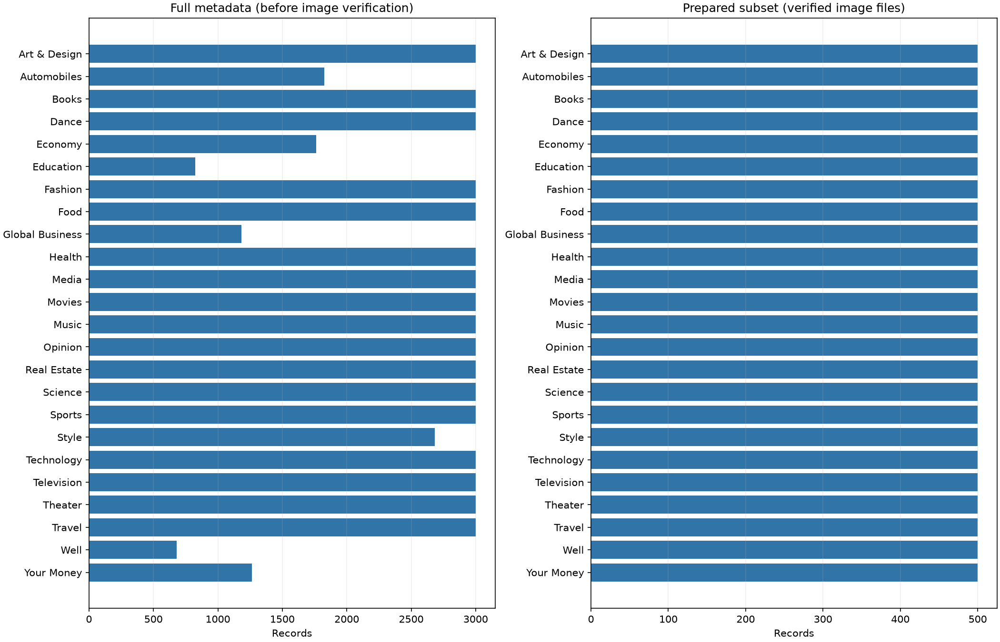
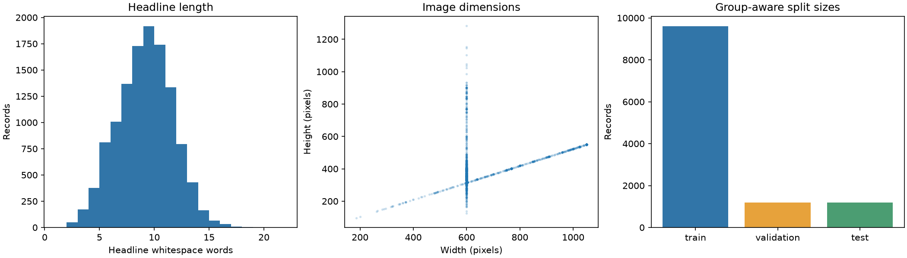

# N24News: data preparation and EDA

This report is generated from the downloaded/audited subset. It contains no model results.

## Scope and provenance

- Full metadata: 61,218 records; selected subset: 12,000.
- Verified, complete image/headline pairs: **12,000**, across **24 classes**.
- Image source variant: `original`; query-only rendering parameters removed from the same public asset path.
- Selection seed: 44; selected-ID SHA-256: `a78456e03205a554f6a441526190af2ca207dc18cb76c1c6258366b084354b34`.
- Download statuses: `{'cached': 11984, 'downloaded': 16}`; valid file bytes: 1,195,861,595.
- Wall time of this downloader invocation: 45.9 seconds. If resumed, this is not the total wall time across all invocations.
- Cleaning exclusions: `{'none': 0}`.
- The balanced subset changes the natural class prior. It is a custom protocol, not the full benchmark or original paper split.

## Distribution and input sizes





Headline length is measured in whitespace words, not DistilBERT tokens. Token-length and truncation checks remain part of the post-approval encoder setup.

| Class | Prepared pairs | Train | Validation | Test |
|---|---:|---:|---:|---:|
| Art & Design | 500 | 400 | 50 | 50 |
| Automobiles | 500 | 400 | 50 | 50 |
| Books | 500 | 400 | 50 | 50 |
| Dance | 500 | 400 | 50 | 50 |
| Economy | 500 | 400 | 50 | 50 |
| Education | 500 | 400 | 50 | 50 |
| Fashion | 500 | 400 | 50 | 50 |
| Food | 500 | 400 | 50 | 50 |
| Global Business | 500 | 400 | 50 | 50 |
| Health | 500 | 400 | 50 | 50 |
| Media | 500 | 400 | 50 | 50 |
| Movies | 500 | 400 | 50 | 50 |
| Music | 500 | 400 | 50 | 50 |
| Opinion | 500 | 400 | 50 | 50 |
| Real Estate | 500 | 400 | 50 | 50 |
| Science | 500 | 400 | 50 | 50 |
| Sports | 500 | 400 | 50 | 50 |
| Style | 500 | 400 | 50 | 50 |
| Technology | 500 | 400 | 50 | 50 |
| Television | 500 | 400 | 50 | 50 |
| Theater | 500 | 400 | 50 | 50 |
| Travel | 500 | 400 | 50 | 50 |
| Well | 500 | 400 | 50 | 50 |
| Your Money | 500 | 400 | 50 | 50 |

## Duplicate grouping and split checks

- Final groups: 11,632; groups with multiple records: 108; largest group: 62.
- Strict perceptual-similarity links: 1749.
- Groups containing multiple editorial labels: 7 (15 records). Different headlines can legitimately share a photo; these groups are retained together, not automatically called annotation errors.
- Exact repeated headline extra records in the subset: 201. Matching normalized headlines are grouped for text-overlap control, not interpreted as event identity.
- **Leakage verification:** Passed: sample IDs, group IDs, pixel/file hashes, canonical image/article URLs and normalized exact headlines disjoint across splits.
- Rules: Full-metadata article/image canonical URL components; selected pixel/file hashes; normalized exact headlines grouped to prevent text memorization; strict perceptual similarity (dHash<=1, RGB thumbnail RMSE<=5, aspect delta<=0.05; flat images excluded).
- Limitation: No complete event-level IDs; broader semantic event overlap remains unverified. Identical headlines are grouped conservatively for text-overlap control, not claimed to be the same event.

Split hashes:

```json
{
  "train": "db4fd9181cba3461ce89f00e60a76e24cdd10f05a2de864be5b8b40a926944f3",
  "validation": "859f0e1e27122e90119f105c5336e57eb35ef2ac6a939750677d8373db1ca63d",
  "test": "6842dee518c99841e8f9da598baf4fafaa76010b32297107973e5a8b2daac034"
}
```

The test manifest is fixed here but has not been evaluated by any model. Use train/validation to select models; test evaluation happens after the experimental design is locked.

## Pair quality and remaining review

A separate AI visual review examined 120 pilot pairs (5 per class); all those IDs are in this selected subset. The review used metadata-rendered images. It recorded 81 pairs with clear topic cues, 37 weak/contextual pairs, and 2 uncertain pairs; this is not a population quality estimate or an independent human audit. The records and limitations are in [pilot review](../pilot_seed44/pair_review.csv) and [pilot summary](../pilot_seed44/pair_review_summary.json).

The pilot showed generic portraits, overlapping editorial topics, reused photos and many Published-year overlays. Original-asset routing was checked and recorded to avoid query-rendered date banners. The current-variant gallery and blank human review form are provided in `review_gallery/` and `pair_review.csv`; rerunning preparation preserves existing review notes for matching IDs.

Dataset usage conditions and instructor approval are not yet recorded. Review [the proposal](../../../assignment3/PROPOSAL.md) and fill in the official Group Name, responsible member and approval record before main experiments.
